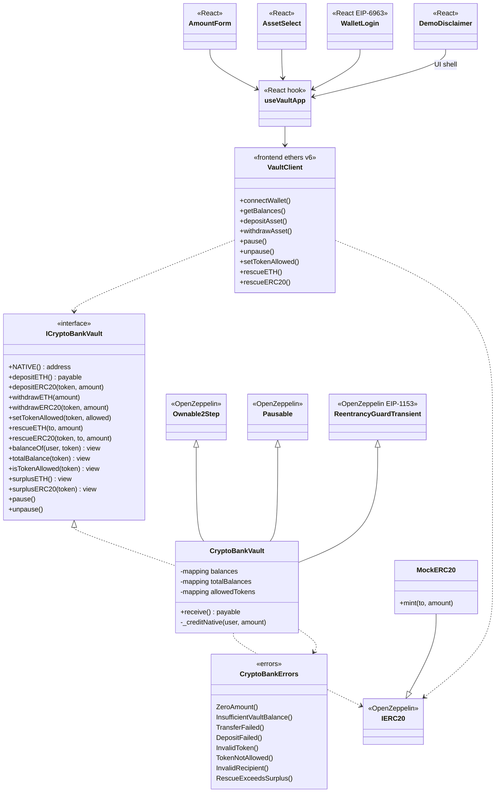

# Class diagram — Crypto Bank Vault
> 🇪🇸 [Versión en español](./01-diagrama-clases-ES.md)

Static view of types, responsibilities and relationships between the on-chain contracts and the frontend layer (ethers.js). Aligned with the final implementation (Phase 6).

---

## 1. Class diagram (on-chain + frontend)

---

## 2. Design notes

### 2.1 Ledger

- `balances[user][token]`; ETH = `NATIVE` (`address(0)`).
- `_totalBalances[token]` for surplus / rescue.

### 2.2 ERC-20

- Deposits only if `isTokenAllowed(token)`.
- `depositERC20` credits the **delta** of `balanceOf` (fee-on-transfer on deposit).
- Withdrawals do not require the allowlist (balances already credited).

### 2.3 OZ inheritance

- Ownable2Step + Pausable + ReentrancyGuardTransient (Cancun).

### 2.4 Frontend

- `VaultClient` + `useVaultApp`; assets from `NEXT_PUBLIC_ASSETS` (`SYM:native[:d]` / `SYM:0x…[:d]`).
- Test disclaimer + `/ayuda.html`.
- Signed login = demo UX (no SIWE server).

### 2.5 Events

`Deposited`, `Withdrawn`, `TokenAllowlistUpdated`, `Rescued`, plus `Paused`/`Unpaused` from OZ.

---

## 3. Solidity layout convention

1. Imports  
2. Errors / events (in interface + implementation per the current design)  
3. Constants  
4. State  
5. Constructor  
6. `receive`  
7. Externals → views → internals  
