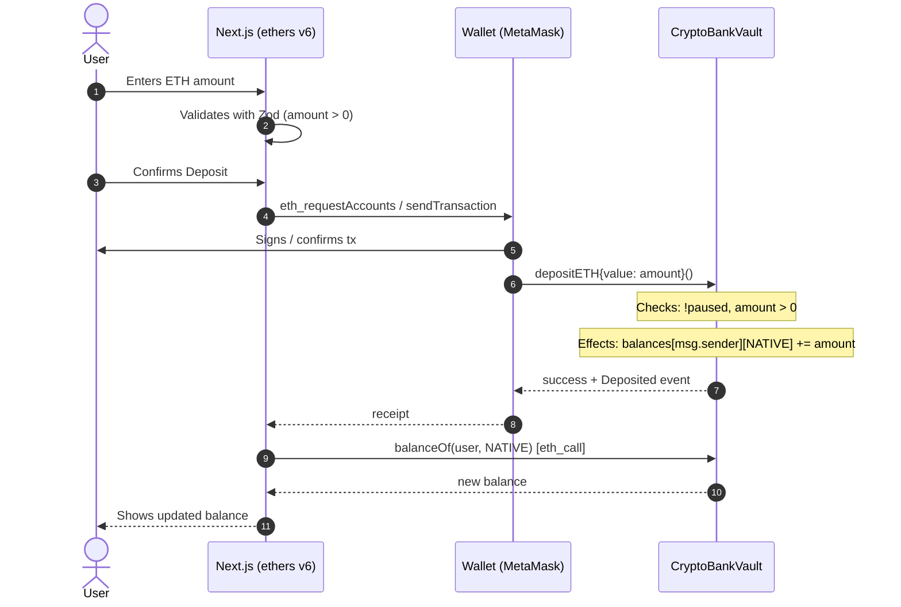
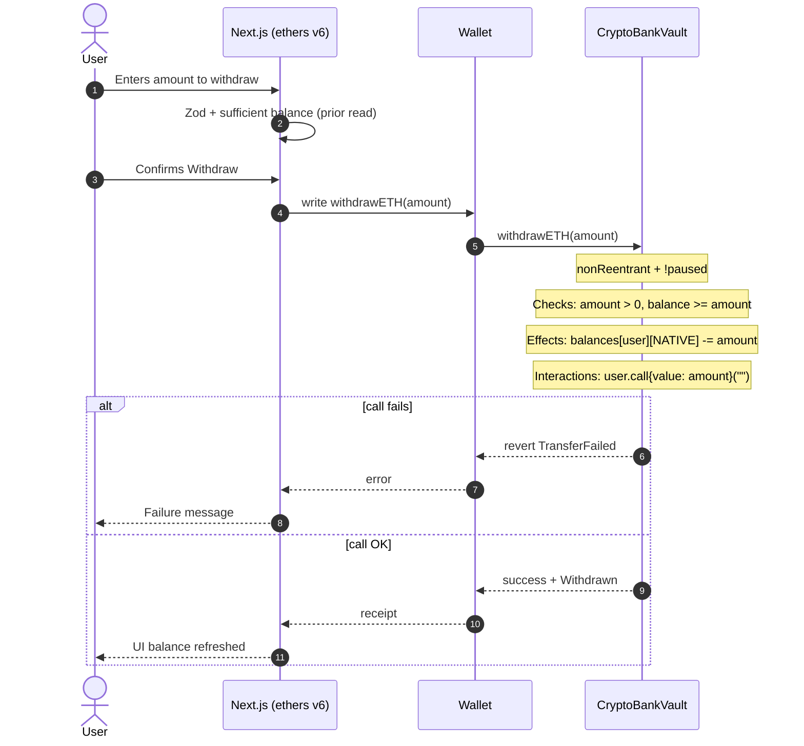
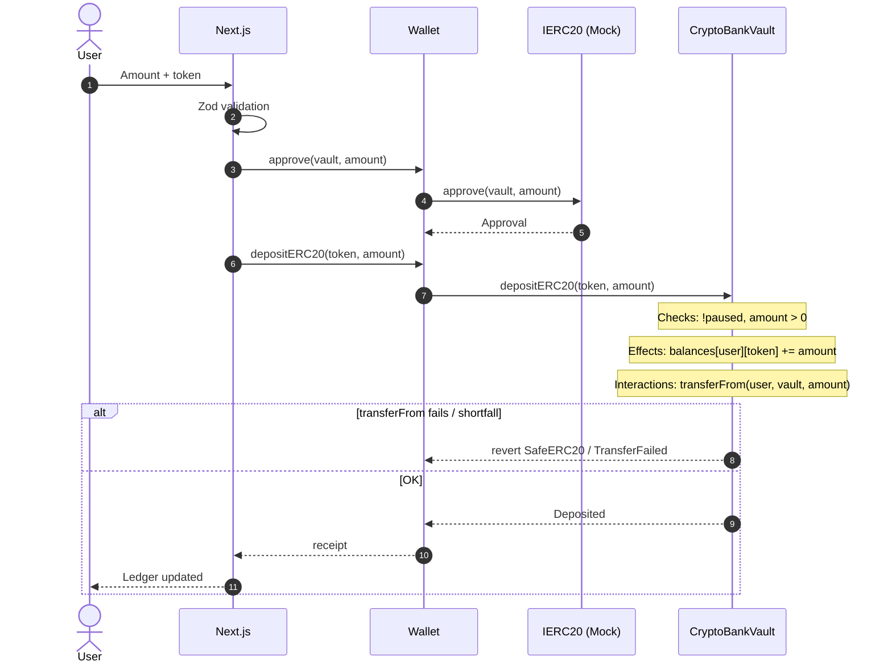
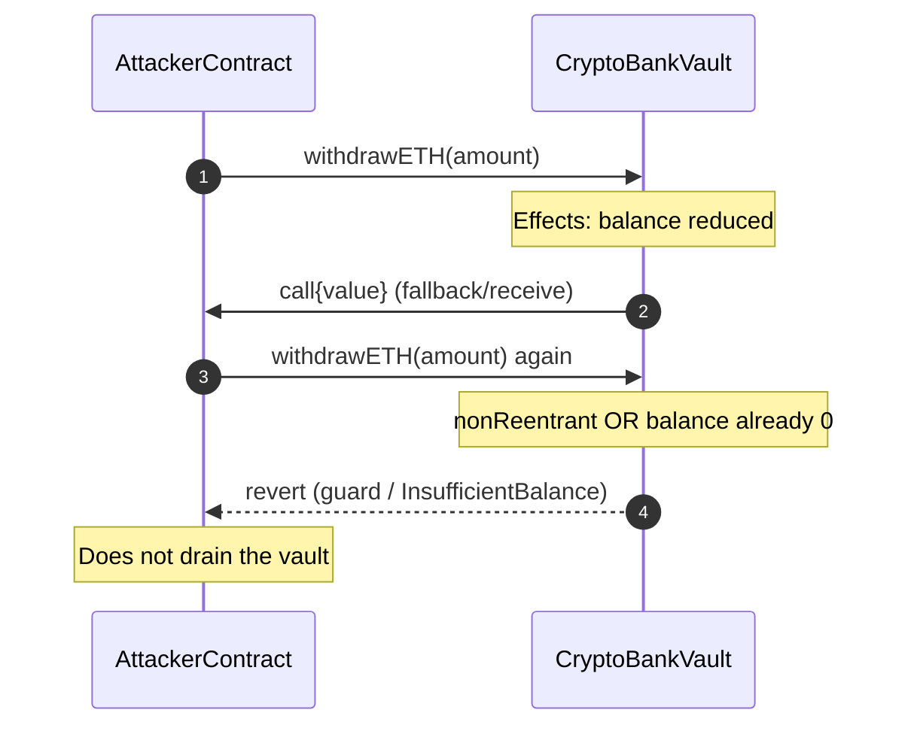
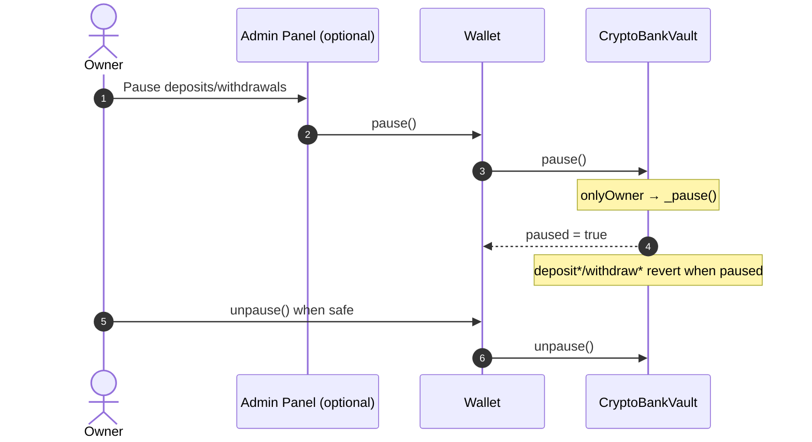
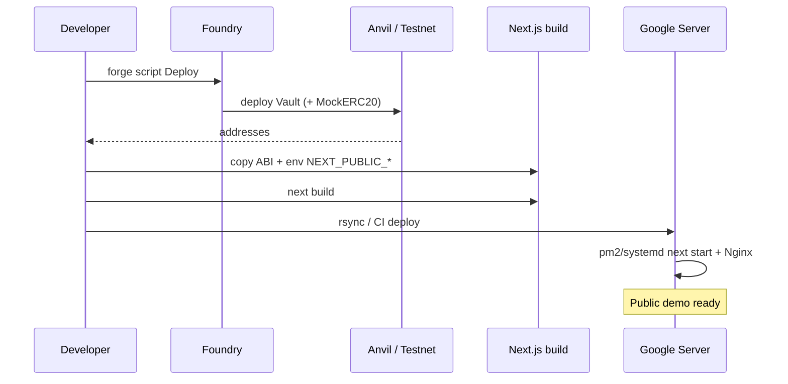

# Flow diagram — Crypto Bank Vault
> 🇪🇸 [Versión en español](./02-diagrama-flujo-ES.md)

Interaction sequences between the **user**, the **frontend (ethers.js)** and the **contracts**. Complements the [decision flowchart](./03-flujograma-EN.md).

---

## 1. ETH deposit

---

## 2. ETH withdrawal (CEI + call)

---

## 3. ERC-20 deposit (approve + deposit)

> **CEI note:** the exact effects↔`transferFrom` ordering must be pinned down in the implementation and tests. For honest tokens, a safe pattern is: checks → effects (credit) → `transferFrom` → if it fails, revert (tx rollback). Conservative alternative: `transferFrom` measuring the balance delta and then effects; document the choice in NatSpec.

---

## 4. Reentrancy attack (must fail)

---

## 5. Emergency pause (owner)

---

## 6. Demo deployment flow (Google VPS)

