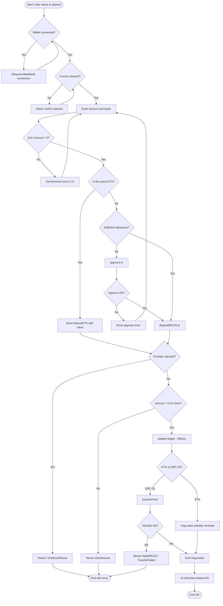
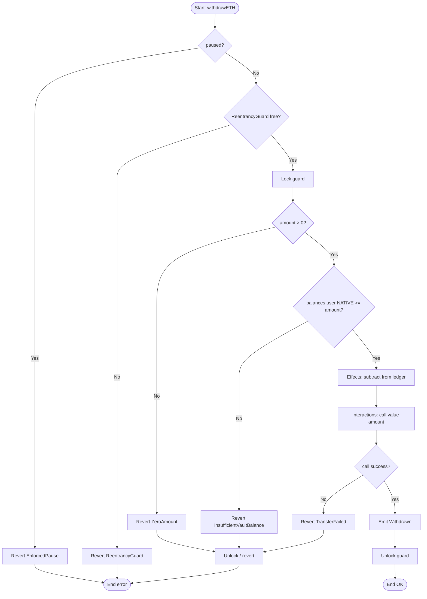
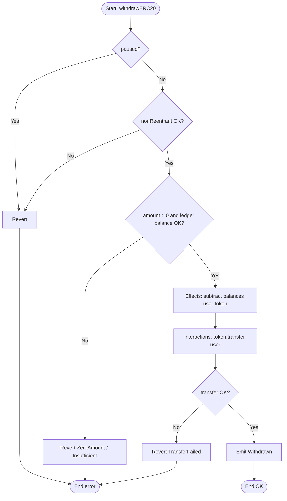
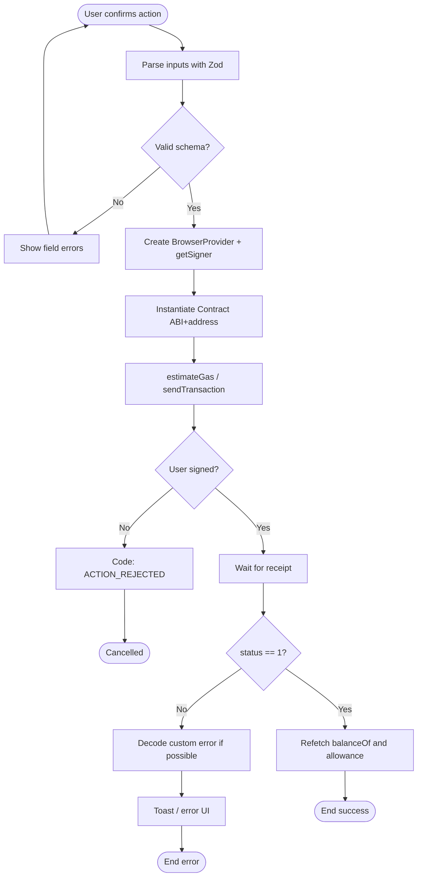
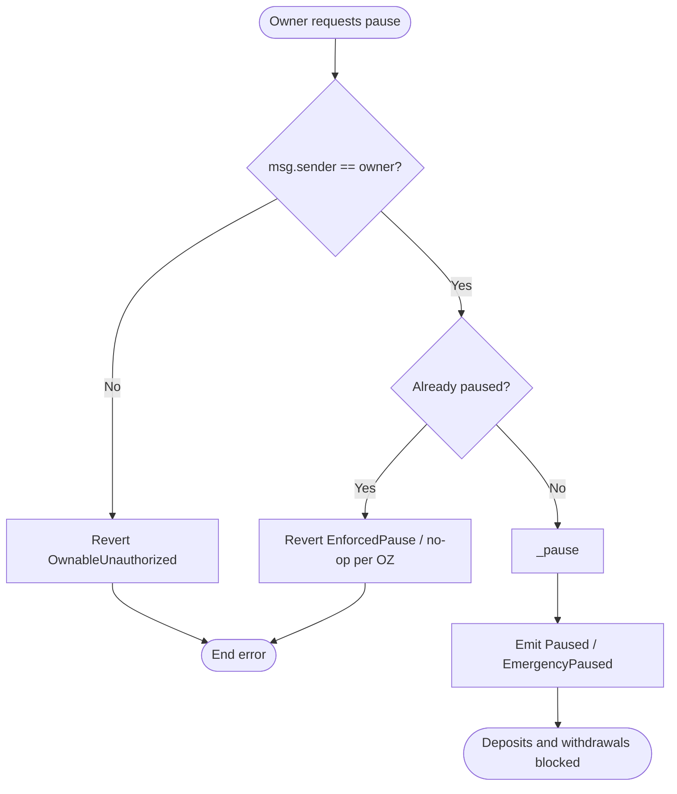

# Flowchart — Crypto Bank Vault
> 🇪🇸 [Versión en español](./03-flujograma-ES.md)

Decision diagrams (yes/no) for the critical operations of the vault and the frontend. See also the [flow / sequence diagram](./02-diagrama-flujo-EN.md).

---

## 1. General flowchart: deposit (ETH or ERC-20)

---

## 2. Flowchart: ETH withdrawal

---

## 3. Flowchart: ERC-20 withdrawal

---

## 4. Flowchart: frontend — transaction submission

---

## 5. Flowchart: owner operation — pause

---

## 6. Quick legend

| Symbol | Meaning |
|---------|-------------|
| Oval | Start / end |
| Rectangle | Process or state effect |
| Diamond | Decision |
| CEI | Checks → Effects → Interactions, in that order |
| Guard | `nonReentrant` prevents reentry during `call` |
